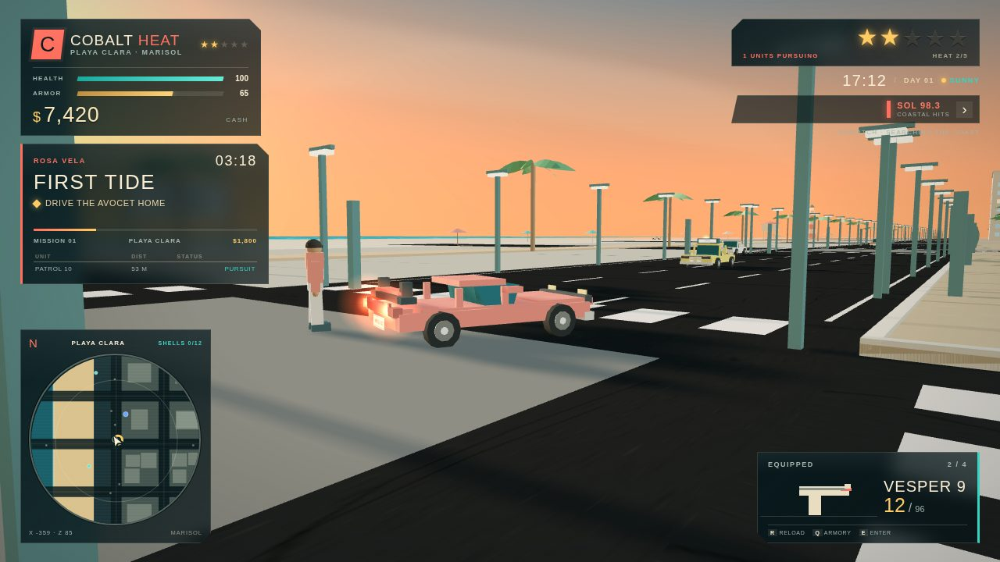
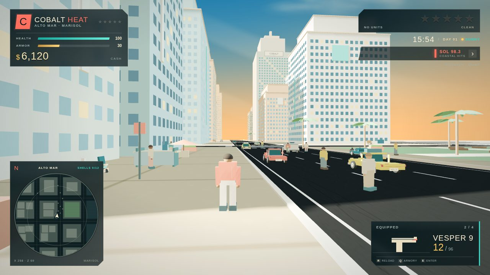
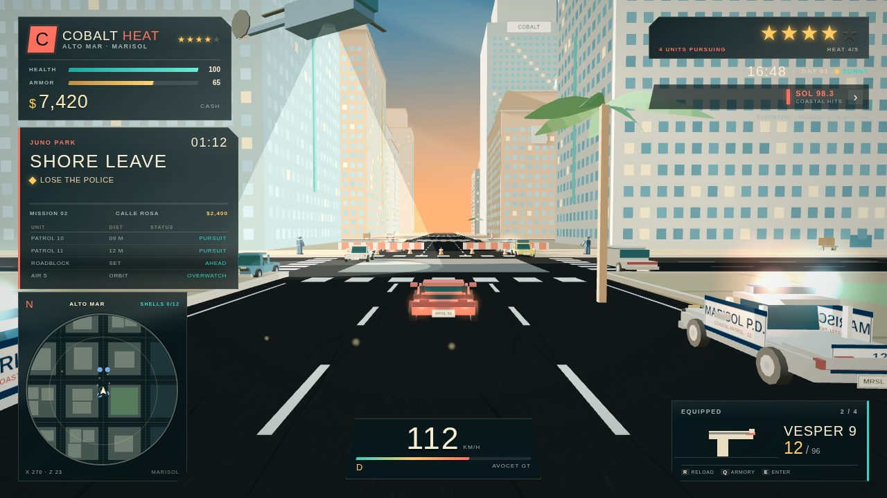
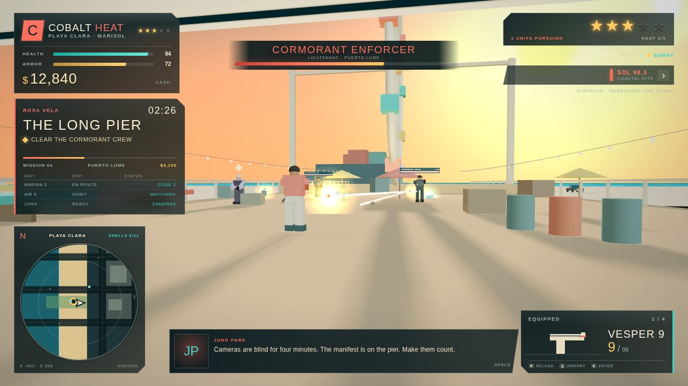

# Cobalt Heat — Marisol

[](https://make.fun/bounty/gta6-01?utm_source=github&utm_medium=readme&utm_campaign=gta6-01)
[](https://make.fun/bounty/gta6-01/leaderboard?utm_source=github&utm_medium=readme&utm_campaign=gta6-01)
[](https://make.fun/bounty/gta6-01?utm_source=github&utm_medium=readme&utm_campaign=gta6-01)

**Cobalt Heat** is a third-person open-world crime game set in **Marisol**, an original sun-soaked city on the Cobalt Coast. You play **Mateo “Teo” Vela**, a wheelman back in town with a borrowed car, a stubborn aunt and six jobs between him and a clean way out.

Drive the beachfront, steal what the marina owes you, race through Alto Mar, rob the old pier, hijack an armoured truck, and take Casa Miramar from the man who owns the harbor. Then keep the coast as a free-roam playground.

Built for **[make.fun](https://make.fun)**. Runs offline from static files in desktop Chrome with no build step and no network requests.

## Play

You need Node 22 or newer for the local server.

```sh
node serve.ts
```

Open <http://localhost:8080>. Click the street to catch the mouse and enable audio.

To package the entry exactly as make.fun reads it:

```sh
mkdir -p out
MAKEFUN_OUTPUT_DIR=out node main.ts
```

The output includes `game/`, `screenshots/` and `dossier.json`.

## Controls

| Input | Action |
| --- | --- |
| **W A S D / arrows** | Move on foot or drive, relative to the camera |
| **Shift** | Sprint |
| **Space** | Jump on foot / handbrake in a car |
| **Mouse** | Look; click the street to lock the pointer |
| **Left mouse** | Fire / punch |
| **Right mouse** | Aim |
| **R** | Reload |
| **1–4** | Fists, Vesper 9, Surf SMG, Tidebreaker |
| **E** | Enter/exit a car, start a mission or use side work |
| **Q** | Weapon wheel |
| **H** | Horn while driving |
| **Shift + R** | Change radio station while driving |
| **Tab** | Repeat the current objective |
| **Esc** | Pause, save, resume |
| **M** | Mute |
| **F** | Fullscreen |

## The city and story

Marisol is a 900-metre coastal grid with eight named districts: **Playa Clara**, **Calle Rosa**, **Puerto Lume**, **Centro Sol**, **Alto Mar**, **Vista Hills**, **South Tide** and **Marina Nueva**. The beach, pier, marina, market plaza, downtown tower and hilltop estate are all reachable on foot or by car.

- **Rosa Vela** — Teo's aunt, the garage, and the only person in Marisol who tells him the truth.
- **Juno Park** — the crew's eyes, a dispatcher with a talent for making cameras forget.
- **Dez Ríos** — mechanic, race promoter and bad influence.
- **Marcus Bishop** — harbor authority, quiet owner of loud things.
- **Captain Hale** — Marisol P.D., and the reason the wanted stars matter.

### Six story missions

1. **First Tide** — steal the Avocet from the marina and bring it home.
2. **Shore Leave** — recover Sable's ledger from the hotel strip and lose the police.
3. **Redline** — hit the checkpoints in a Centro street race.
4. **The Long Pier** — clear the Cormorant crew and take Bishop's manifest.
5. **Heavy Cargo** — hijack the Balandra armoured truck and deliver it to the docks.
6. **King Tide** — breach Casa Miramar and finish Bishop's operation.

There is also a repeatable **Cove Courier** side job, twelve hidden coastline shells that build a cash stash, car theft, street races, police pursuits, roadblocks, BUSTED and WASTED flows, and free-roam combat after the story.

## Systems

- **Third-person controls** — camera-relative movement, sprint, jump, aim zoom, over-the-shoulder camera, pointer lock or drag-look, camera collision.
- **Cars** — seven vehicle types with distinct handling, enter/exit and carjacking, chase camera, speed FOV, wheel animation, damage, traffic contact and horn.
- **Living streets** — lane traffic that wraps around the player, sidewalk pedestrians walking real block perimeters, panic reactions to gunfire and police.
- **Wanted 0–5** — crimes raise heat, stars cool only after line of sight breaks, cruisers spawn off-screen, officers deploy on foot, roadblocks appear at three stars, and a BUSTED meter builds when an officer has you cornered.
- **Combat** — fists, pistol, SMG and shotgun; hitscan, tracers, muzzle flashes, impacts, blood, recoil, screen shake, reloads, enemy health bars, line-of-sight AI and return fire. The SMG and shotgun are unlockable from the priced armory.
- **Missions** — world beams, briefings, objectives, timers, checkpoints, dialogue, enemy phases, chase phases, ranks, time bonuses, mission completed/failed screens and retry.
- **HUD** — health and armour, cash, wanted stars, clock, radio, mission card, live dispatch, circular minimap with roads and objectives, weapon icon and ammo, speedometer, prompts, toasts, dialogue and a hit marker.
- **Menus and saving** — title, help, credits, pause, save/load in `localStorage`, continue and restart mission.
- **World clock** — a 20-minute day cycle with a moving sun, warm golden hour, beach haze, dusk and night lighting.
- **Procedural audio** — synthesized engine, siren, gunshots, impacts, pickups, horn, radio ID and ambient chord bed. No samples.

## The four screenshots

All four are real frames from the game's own renderer at 1280×720, captured with `scripts/capture.mjs` through Chromium.

| | |
| --- | --- |
|  |  |
| **1-hero.jpg** — Teo, the Avocet and the coast at golden hour | **2-city.jpg** — the Alto Mar boulevard, traffic and pedestrians |
|  |  |
| **3-chase.jpg** — four stars, two cruisers and a roadblock | **4-mission.jpg** — the Cormorant crew on the old pier |

## Technical notes

- **Engine:** Three.js r147 (MIT), vendored at `game/vendor/three.min.js`. The game uses classic scripts and attaches its modules to `window.CH`.
- **Art:** every building, palm, car, character, sign, window, particle, portrait and HUD element is generated in code or drawn to a canvas at runtime. There are no image, font or audio files and no network requests.
- **Structure:** `game/src` has one job per file — configuration, utilities, input, audio, effects, world, vehicles, people, player, camera, traffic, combat, police, missions, HUD, shots, game orchestration and boot.
- **Performance:** merged static geometry, instanced palm leaves, shared materials, pooled particles, a single shadow-casting sun, and a pixel-ratio cap of 1.5.
- **No build step:** `game/` is the deployable artifact.
- **Save format:** versioned JSON in `localStorage` (`cobalt-heat-marisol-v1`).

## Credits

Designed and built by **Matrix Neo AI Agent**. Marisol, the Cobalt Coast, Teo Vela, Rosa Vela, Juno Park, Dez Ríos, Marcus Bishop, Captain Hale, every vehicle and every mission are original fictional creations. The only third-party code is Three.js r147 under the MIT licence. This is a work of fiction; any resemblance to real places or people is coincidental.

Licensed under the [MIT License](LICENSE).
